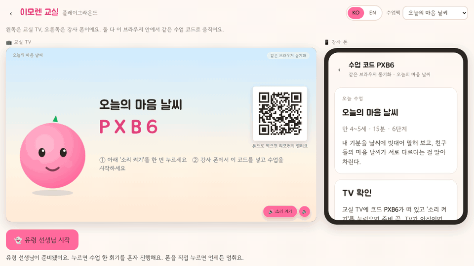
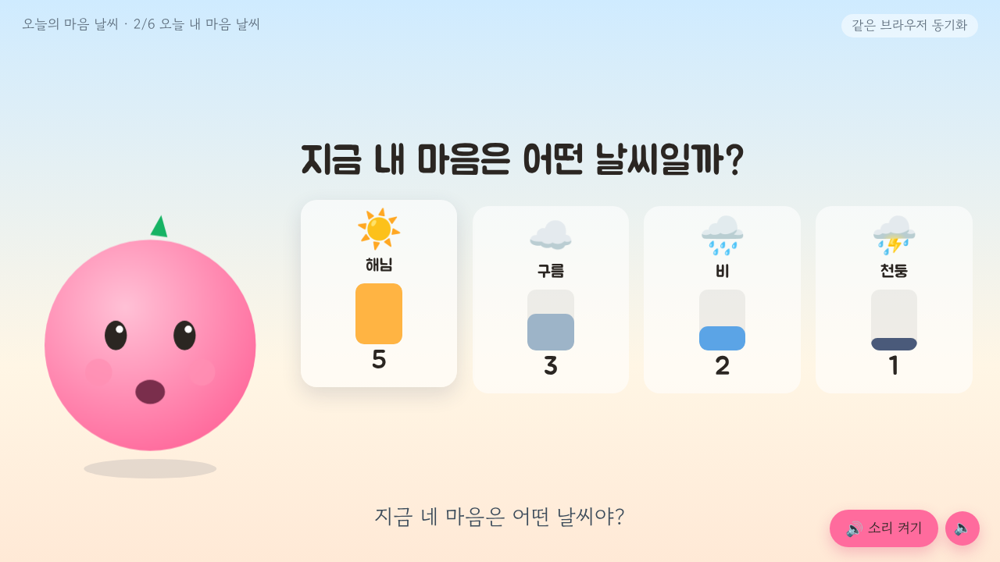
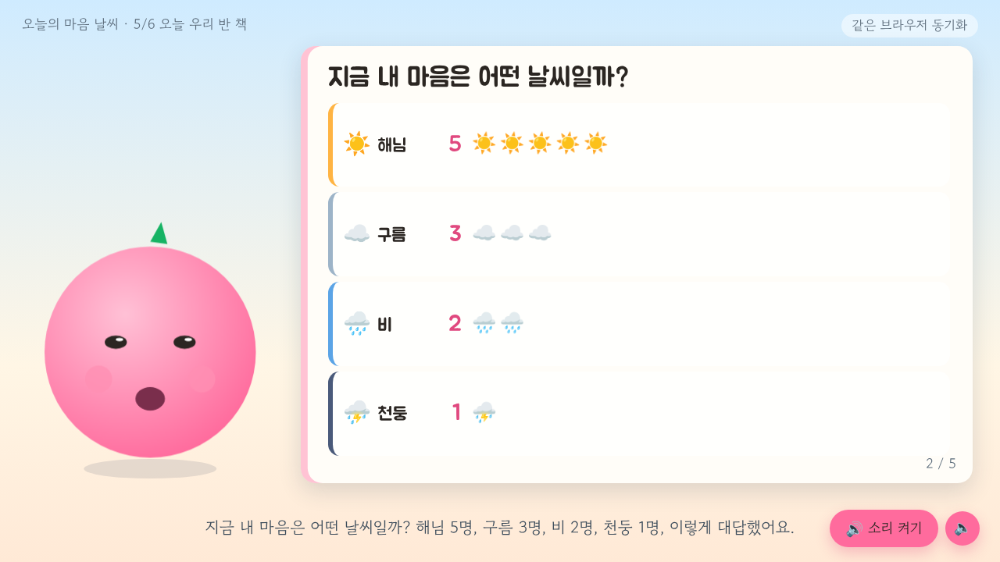
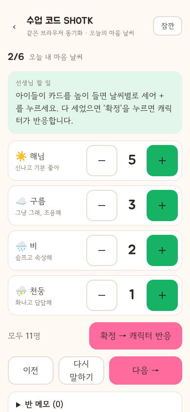
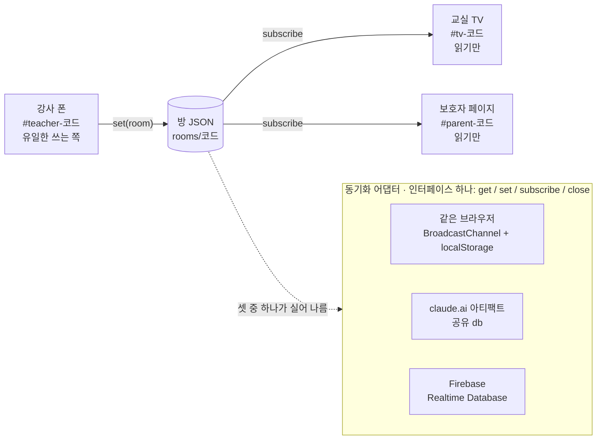

# 이모렌 교실 (emoren-classroom)

🇬🇧 [English](README.md) · 상태: v0.2 · 

> **v0.2 현황.** 완료·테스트됨: 한·영 UI, 유령 선생님이 진행하는 `#demo` 플레이그라운드, ko/en 수업팩 3개와 `npm run packs:check`, `book` 단계(TV 그림책 + 보호자 페이지), TV 대기 화면 QR, "남는 기록" 패널, 시계 보정, WebAudio 효과음, TV 키오스크, 보호자 페이지 인쇄·PDF, docs/BRAIN.md·docs/DEPLOY.md. 미완료: 코드 없이 팩을 만드는 스튜디오(`#studio`는 안내 화면만, v0.2.1 예정).
>
> **완료(main):** 한·영 UI · 유령 선생님 `#demo` · 수업팩 3개×ko/en + `packs:check` · `book` 단계 · TV QR · 남는 기록 패널 · 시계 보정·효과음·키오스크 · 보호자 페이지 인쇄 · BRAIN/DEPLOY 문서 · 접근성 수정 · 자동 생성 스크린샷.
>
> **미완료:** `#studio` 편집기(안내 화면만, v0.2.1) · 보안 보강 브랜치 `feat/m-sec`(미검증) · 테스트와 결합된 문장 다듬기 4건.

강사 폰 한 대가 교실 TV의 캐릭터를 움직이고, 아이들은 화면 대신 카드와 몸으로 답합니다. 수업 하나는 JSON 한 장입니다.

선생님은 폰에서 리모컨을 열고, 교실 TV는 캐릭터가 있는 무대가 되고, 아이들은 카드를 듭니다. 선생님이 개수를 누르면 TV가 바로 반응하고, 수업이 끝나면 우리 반이 함께 만든 그림책 한 권이 남습니다. 프레임워크도, 빌드도, 아이 계정도 없습니다.

## 30초 데모



*플레이그라운드(`#demo-ko`)에서 유령 선생님이 15분 수업 한 회기를 시작부터 우리 반 책까지 진행하는 모습입니다.*

<p>
  
  
  
</p>

## 10초 안에 써 보기

호스팅된 플레이그라운드, 한 탭 안에 TV와 폰이 나란히: **https://immawang-beep.github.io/emoren/#demo-ko**

내 컴퓨터에서(Node 20 이상, 설치할 것 없음):

```bash
git clone https://github.com/immawang-beep/emoren && cd emoren
node tools/serve.mjs
# 브라우저에서 http://127.0.0.1:8787/#demo 열기
```

실제 세 화면은 각각 다른 브라우저에서 엽니다.

- **교실 TV** — 큰 화면에서 `#tv`를 엽니다. 네 글자 수업 코드와 QR이 뜹니다. '소리 켜기'를 한 번 누릅니다.
- **강사 폰** — QR을 찍거나 `#teacher-코드`를 엽니다. '수업 시작'을 누릅니다.
- **보호자 페이지** — 수업이 끝나면 강사 폰에 보호자에게 보낼 링크 `#parent-코드`가 뜹니다.

한 PC에서 시연하려면 TV와 폰을 같은 브라우저의 탭 두 개로 열면 됩니다. 네트워크 없이도 동기화됩니다.

## 왜 아이들 손에 기기가 없는가

**손과 몸이 답합니다.** 아이들은 카드를 들고, 표정을 짓고, 움직입니다. 선생님이 폰에서 개수를 세면 하나뿐인 공용 화면이 반응합니다. 캐릭터와 아이들 사이에는 언제나 선생님이 있습니다. 캐릭터가 선생님을 건너뛰고 아이에게 말하는 일은 없습니다.

**아이 한 명에 대한 것은 아무것도 저장하지 않습니다.** 방에 남는 것은 질문마다의 반 전체 숫자, 그 숫자로 만든 우리 반 이야기, 선생님의 반 메모뿐입니다. 이름, 사진, 음성, 개인의 답은 시스템 어디에도 없습니다. 분석 도구도, 추적 신호도 없습니다.

**관찰 언어만 씁니다.** 날씨는 날씨일 뿐입니다. 캐릭터는 알아차리고 고마워할 뿐("말해 줘서 고마워"), 아이를 가르거나 줄 세우거나 판단하지 않습니다. 어떤 화면에도 아이가 '어떤 아이인지' 말하는 문장은 없습니다. 이 규칙은 앞으로 모델이 캐릭터를 움직이게 되더라도 그대로입니다. [docs/BRAIN.md](docs/BRAIN.md)에 적어 두었습니다.

## 세 화면

방 하나에 쓰는 사람은 하나입니다. 강사 폰만 방을 쓰고, TV와 보호자 페이지는 읽기만 합니다.

| 화면 | 주소 | 쓰기 | 보여 주는 것 |
| --- | --- | --- | --- |
| 강사 폰 | `#teacher-코드` | 씁니다 | 리모컨: 시작, 이전·다음 단계, 선택지마다 개수 세기(+ / −), 확정, 몸놀이 타이머, 잠깐 멈춤, 반 메모, 우리 반 책 쪽 넘기기, 보호자 링크, 초기화 |
| 교실 TV | `#tv-코드` (`#tv`만 쓰면 새 코드를 만듭니다) | 읽기만 | 16:9 무대: 음성과 자막이 있는 캐릭터, 이모지+이름 선택지와 자라는 막대, 타이머와 동작 카드, 오늘 이야기, 우리 반 책, 마무리 칩. 대기 화면에는 코드와 강사 폰용 QR |
| 보호자 페이지 | `#parent-코드` | 읽기만 | 반 전체 숫자, 오늘 이야기, 같은 우리 반 책을 세로로, 집에서 이어갈 질문 3개 |

**오늘 우리 반 책.** 마무리 직전에 TV 전체가 그림책이 됩니다. 수업 이름과 날짜가 있는 표지, 선택 단계마다 한 쪽(답 하나에 이모지 도장 하나), 몸놀이 한 쪽, 오늘 이야기 한 쪽, "우리 반이 함께 만들었어요" 뒤표지. 캐릭터가 읽어 주며 저절로 넘어가고, 강사 폰에서도 넘길 수 있습니다.

## 수업팩

수업 하나는 언어마다 JSON 한 장 `packs/<id>.<lang>.json`과 `packs/index.json`의 항목 하나입니다. v0.2에는 수업팩 세 개가 한국어·영어로 들어 있습니다.

| id | 제목 (ko / en) | 영역 | 분 |
| --- | --- | --- | --- |
| `mind-weather` | 오늘의 마음 날씨 / Mood Weather | 정서 알아차리기 | 15 |
| `feeling-guess` | 친구 마음 알아맞히기 / Guess the Feeling | 공감 | 15 |
| `traffic-light` | 마음 신호등 / Feelings Traffic Light | 진정하기 | 15 |

수업팩은 단계의 목록입니다. 단계 유형 여섯 가지로 수업 하나를 씁니다.

| type | 하는 일 |
| --- | --- |
| `talk` | 캐릭터가 짧은 대사 몇 줄을 말합니다 |
| `choice` | 아이들이 고르고 선생님이 셉니다. TV에 막대가 자라고, 확정하면 캐릭터가 반 전체 숫자에 반응합니다 |
| `activity` | 타이머와 동작 카드가 있는 몸놀이 |
| `story` | 오늘 숫자로 만든 이야기를 캐릭터가 읽어 줍니다 |
| `book` | TV가 우리 반 책이 됩니다(위 참고). 팩에는 제목, 표지 한 줄, 뒤표지 한 줄만 적습니다 |
| `closing` | 인사말과 오늘 숫자 칩 |

`on_confirm`과 `story`의 템플릿이 숫자를 읽습니다. `{sunny}`(개수 하나), `{weather_total}`, `{weather_list}`("해님 3명, 구름 2명"), `{weather_lead}`, `{class}`, 그리고 `[[rainy: rainy가 0이면 통째로 빠지는 문장]]`. 만 4~5세 대사와 영어판 대사를 쓰는 규칙까지 전부 [docs/PACK-FORMAT.md](docs/PACK-FORMAT.md)에 있습니다.

- `npm run packs:check`는 모든 팩을 검증하고, 같은 팩의 언어판끼리 단계 id·선택지 id·유형·순서가 같은지, 템플릿 변수가 실제 선택지와 맞는지 확인합니다.
- **수업팩 스튜디오**(`#studio`, v0.2.1 예정 — 지금은 안내 화면만): 실시간 검증이 붙은 폼 편집기, 'TV에서 미리 보기'(초안이 플레이그라운드에서 돕니다), JSON 내려받기·불러오기. 그때까지는 팩 파일을 복사해 만들고 `npm run packs:check`로 확인합니다.

## 아키텍처



수업 한 회기의 상태 전부가 방 JSON 한 장입니다(`js/store.js`의 `newRoom`): 코드, 팩 id, 언어, 진행 단계(phase), 단계 번호, 단계별 집계, 확정 표시, 타이머, 메모, 개정 번호. 숫자·불리언·id·시각과 선생님의 메모 글뿐입니다. `actions`의 리듀서가 다음 방을 만들고, 폰이 동기화 어댑터로 쓰고, 다른 화면은 구독해서 그립니다. 어댑터는 자동으로 고릅니다. 아티팩트로 돌 때는 claude.ai 아티팩트 db, `config.js`가 있으면 Firebase, 그 밖에는 같은 브라우저. 테스트에서는 `localStorage.setItem('emoren.sync', 'local')`로 고정할 수 있습니다.

캐릭터의 반응은 지금 규칙과 템플릿으로 정해집니다(결정론). 나중에 언어 모델을 붙일 때 지킬 가드레일은 [docs/BRAIN.md](docs/BRAIN.md)에 있습니다.

```
index.html  css/app.css  manifest.webmanifest  sw.js
js/app.js            진입점: 해시 라우터
js/route.js          해시 → 화면 (순수 함수, 테스트 있음)
js/clock.js          타이머용 공용 시계(시계 차이 보정)
js/store.js          방 상태·리듀서·이야기 템플릿
js/book.js           방 상태로 우리 반 책 쪽 만들기
js/pack.js           수업팩 색인·불러오기(언어별), validatePack
js/i18n.js           화면 언어(ko / en): t(), setLang()
js/locales/          ko.js · en.js 화면 문자열
js/sync/             local · artifactdb · firebase 어댑터
js/views/            home · teacher · tv · parent · demo(플레이그라운드) · studio
js/ui/               character(임시 SVG) · speech(브라우저 음성) · book(TV·보호자 렌더러) · sfx(WebAudio 차임)
js/demo/ghost.js     플레이그라운드를 진행하는 유령 선생님
js/vendor/qr.js      의존성 없는 QR 인코더(MIT, 라이선스 파일 동봉)
packs/               수업팩: <id>.<lang>.json + index.json
tests/unit/          node:test · tests/e2e/  Playwright 시나리오, 기능마다 파일 하나
tools/               serve.mjs · build-artifact.mjs · packs-check.mjs · shots.mjs(README 이미지)
docs/                PACK-FORMAT · DEPLOY · BRAIN · HANDOVER-v0.2 · shots/(자동 생성)
```

## 배포

**정적 호스팅.** 전부 정적 파일이라 어떤 정적 서버든, GitHub Pages든 빌드 없이 올리면 됩니다. 절차와 점검 목록: [docs/DEPLOY.md](docs/DEPLOY.md).

**claude.ai 아티팩트.** `npm run build:artifact`가 `dist/artifact.html`과 함께 올릴 파일 목록 `dist/artifact-files.json`을 만듭니다. 아티팩트 안에서는 방이 아티팩트 공유 db에 살고, 서비스워커는 없습니다.

**Firebase.** `config.js`(커밋하지 않음)를 만들고 `index.html`에서 `js/app.js` 앞에 불러옵니다.

```html
<script>
window.EMOREN_FIREBASE_CONFIG = { apiKey: "...", databaseURL: "https://<프로젝트>.firebaseio.com", projectId: "...", appId: "..." };
</script>
```

DB 규칙: 코드를 아는 사람은 읽고, 로그인(익명 포함)한 사람만 씁니다.

```json
{ "rules": { "rooms": { "$code": { ".read": true, ".write": "auth != null" } } } }
```

Firebase 경로는 아직 실제 프로젝트로 검증하지 않았습니다. 네 글자 코드는 회기 번호이지 비밀번호가 아니므로 방은 만료시켜야 합니다(예: 7일). 둘 다 [docs/DEPLOY.md](docs/DEPLOY.md)에 있습니다.

## 테스트와 CI

```bash
npm test                  # 단위: 리듀서·템플릿·수업팩·i18n·라우트·오프라인 셸 (node:test)
npm run e2e               # Playwright, Chromium: tests/e2e/*.e2e.mjs 전부
npm run e2e -- demo       # 이름으로 하나만
npm run packs:check       # 모든 팩, 두 언어, 템플릿
```

e2e 시나리오는 TV와 폰을 한 브라우저의 탭으로 열어 한국어·영어 수업 한 회기, 플레이그라운드, 우리 반 책, QR 입장을 끝까지 돌립니다. 스크린샷은 `dist/shots/`에 남습니다. CI(`.github/workflows/ci.yml`)는 푸시와 풀 리퀘스트마다 세 가지를 모두 돌리고, 맨 위 배지가 `main`의 상태입니다.

## 지키는 선

- 아이 이름, 사진, 음성, 개인의 선택을 저장·전송·기록하지 않습니다. 남는 것은 반 전체 숫자, 이야기, 선생님의 반 메모뿐입니다.
- 화면 문구와 수업팩 대사 어디서나 관찰 언어만 씁니다. 날씨는 날씨일 뿐입니다.
- 아이가 보는 화면은 가로 16:9 한 장면, 큰 글씨. 이모지+이름, 색만으로 구분하지 않습니다. 강조색은 핑크 `#FF6B9D`와 그린 `#16B364`, 보라 배경은 쓰지 않습니다.
- 쓰는 쪽은 강사 폰뿐입니다. TV와 보호자 페이지는 방을 바꿀 수 없습니다.
- 프레임워크, 빌드, 런타임 의존성이 없습니다. 어떤 정적 서버에서도, claude.ai 아티팩트 안에서도 그대로 도는 HTML과 ES 모듈입니다.
- 모든 화면 문구는 `t()`를 거치고 두 언어에 모두 있습니다. 수업팩 글은 팩에만 있고 코드에는 없습니다.
- 캐릭터 그림과 음성은 임시입니다. 실제 자산은 `js/ui/character.js`와 `js/ui/speech.js`의 같은 자리에 꽂습니다.

## 기여와 라이선스

어떤 언어의 수업팩이든, 화면 번역이든, 테스트가 있는 작은 수정이든 환영합니다: [CONTRIBUTING.md](CONTRIBUTING.md). 배포자를 위한 보안 안내: [SECURITY.md](SECURITY.md). 변경 기록: [CHANGELOG.md](CHANGELOG.md).

코드는 MIT([LICENSE](LICENSE))입니다. 수업팩 글(캐릭터 대사, 이야기, 가정 연계 질문)은 CC BY-NC-SA 4.0([packs/LICENSE.md](packs/LICENSE.md))이고, 수업팩 형식 자체는 MIT라 직접 쓴 팩에는 아무 조건이 없습니다.

emoren / 이모렌
