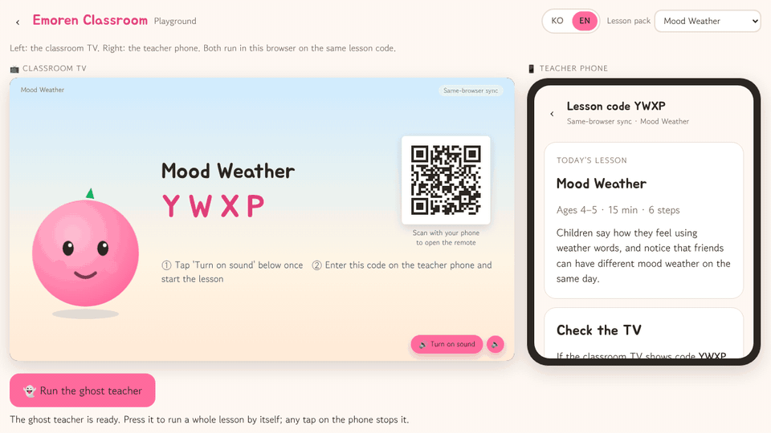
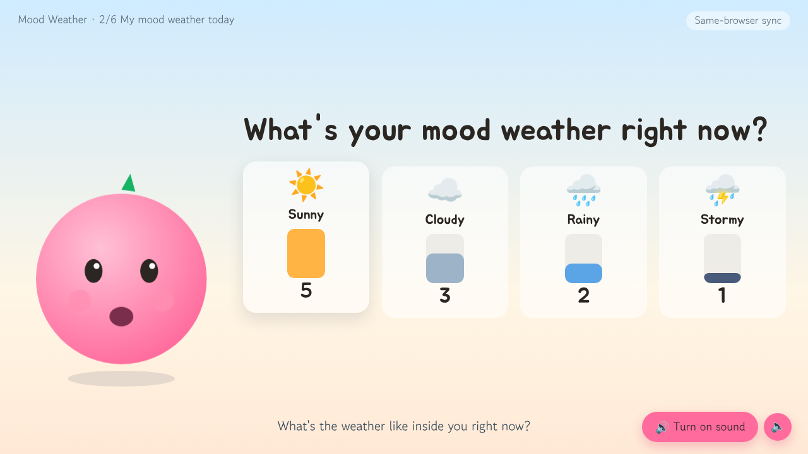
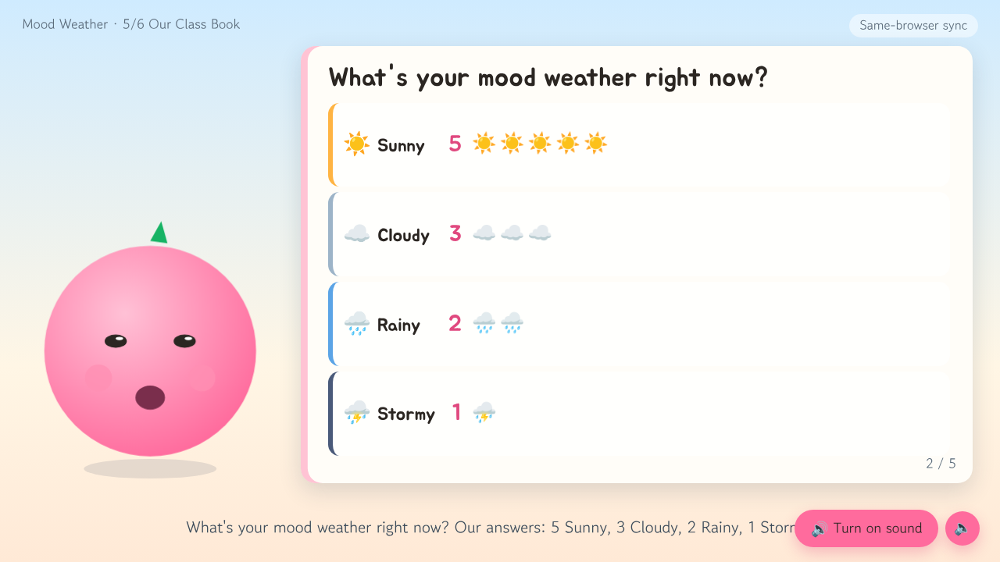
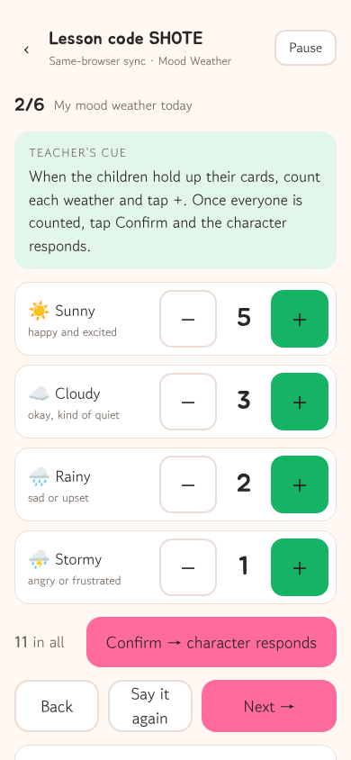
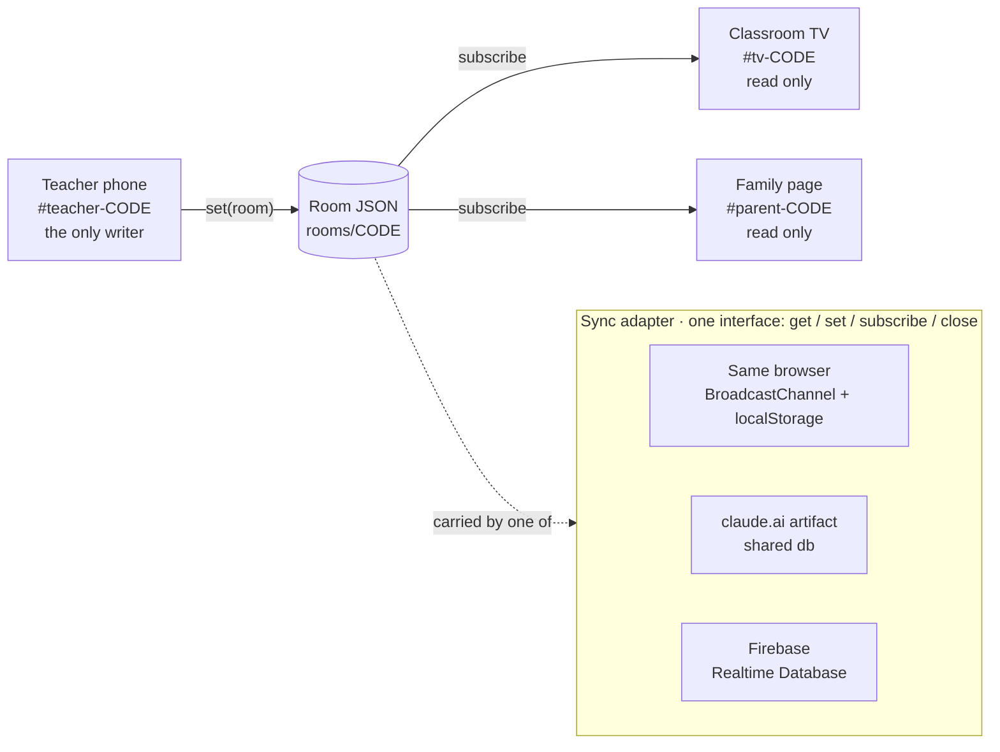

# emoren-classroom

🇰🇷 [한국어](README.ko.md) · Status: v0.2 · 

> **Where v0.2 stands.** Shipped and tested: bilingual UI, the `#demo` playground with a ghost teacher, three lesson packs in ko/en with `npm run packs:check`, the `book` step (TV picture book + family page), the QR code on the TV waiting screen, the "what is stored" panel, clock-offset correction, WebAudio chimes, TV kiosk mode, print/PDF for the family page, docs/BRAIN.md and docs/DEPLOY.md. Not shipped yet: the no-code pack studio (`#studio` shows a placeholder; planned for v0.2.1).
>
> **Done (in `main`):** bilingual UI · `#demo` playground with ghost teacher · 3 packs × ko/en + `packs:check` · `book` step · TV QR · what-is-stored panel · clock offset, chimes, kiosk · family-page print · BRAIN/DEPLOY docs · a11y fixes · generated screenshots.
>
> **Not done:** `#studio` editor (placeholder screen, v0.2.1) · security hardening branch `feat/m-sec` (unverified) · 4 test-coupled copy tweaks.

One phone drives a classroom TV character; children answer with cards and bodies, not screens. Every lesson is one JSON file.

A teacher opens a remote on their phone, the classroom TV becomes a stage with a character, and the children hold up cards. The teacher taps the counts, the TV reacts, and at the end the class gets a picture book it made together. No frameworks, no build step, no accounts for children.

## 30-second demo



*The playground (`#demo`) with a ghost teacher running one 15-minute lesson from start to the class book.*

<p>
  
  
  
</p>

## Try it in 10 seconds

Hosted playground, TV and phone side by side in one tab: **https://immawang-beep.github.io/emoren/#demo**

Locally (Node 20+, nothing to install):

```bash
git clone https://github.com/immawang-beep/emoren && cd emoren
node tools/serve.mjs
# open http://127.0.0.1:8787/#demo
```

The real three screens, each in its own browser:

- **Classroom TV** — open `#tv` on the big screen. It shows a four-letter lesson code and a QR code. Tap "Turn on sound" once.
- **Teacher phone** — scan the QR, or open `#teacher-CODE`. Press "Start lesson".
- **Family page** — when the lesson ends the phone shows a link, `#parent-CODE`, to send to families.

On one computer, open the TV and the phone as two tabs of the same browser; they sync without a network.

## Why the children have no devices

**Hands and bodies answer.** Children hold up a card, make a face, move. The teacher counts on the phone, and the one shared screen reacts. The teacher stays the mediator between the character and the class; the character never talks past the teacher.

**Nothing about an individual child is stored.** The room holds class totals per question, the story the class made from those totals, and the teacher's class note. No names, photos, voice or per-child answers exist anywhere in the system. No analytics, no beacons.

**Observational language only.** A weather is a weather. The character notices and thanks ("thank you for telling me"); it never labels, ranks or judges a child, and nothing on any screen says what a child *is*. These rules also bind any future model-driven character; see [docs/BRAIN.md](docs/BRAIN.md).

## The three screens

One room, one writer. The teacher phone writes the room; the TV and the family page only read it.

| Screen | URL | Writes? | What it shows |
| --- | --- | --- | --- |
| Teacher phone | `#teacher-CODE` | yes | The remote: start, previous / next step, count each option (+ / −), confirm, activity timer, pause, class note, page turns in the class book, family link, reset |
| Classroom TV | `#tv-CODE` (`#tv` makes a new code) | no | A 16:9 stage: character with voice and captions, the question with emoji + label options and growing bars, timer and movement cards, today's story, the class book, closing chips. The waiting screen shows the code and a QR for the phone |
| Family page | `#parent-CODE` | no | Class totals, today's story, the same class book in portrait, three questions to carry on at home |

**The class book.** Just before the closing step the TV becomes a picture book: a cover with the lesson name and date, one page per choice step with one emoji stamp per answer, a page for the movement activity, a page for today's story, and a back cover that says the class made it together. The character reads it aloud and the pages turn by themselves; the phone can turn them too.

## Lesson packs

A lesson is one JSON file per language, `packs/<id>.<lang>.json`, plus an entry in `packs/index.json`. v0.2 ships three packs, each in Korean and English:

| id | Title (ko / en) | Domain | Minutes |
| --- | --- | --- | --- |
| `mind-weather` | 오늘의 마음 날씨 / Mood Weather | Noticing feelings | 15 |
| `feeling-guess` | 친구 마음 알아맞히기 / Guess the Feeling | Empathy | 15 |
| `traffic-light` | 마음 신호등 / Feelings Traffic Light | Calming down | 15 |

A pack is a list of steps. Six step types cover a lesson:

| type | what happens |
| --- | --- |
| `talk` | the character speaks a few short lines |
| `choice` | children choose, the teacher counts; bars grow on the TV; on confirm the character reacts to the class totals |
| `activity` | a movement activity with a timer and movement cards |
| `story` | the character reads a story built from today's counts |
| `book` | the TV becomes the class book (see above); the pack supplies only a title, a cover line and a back-cover line |
| `closing` | goodbye lines and the day's totals as chips |

Templates in `on_confirm` and `story` read the counts: `{sunny}` (one count), `{weather_total}`, `{weather_list}` ("3 Sunny, 2 Cloudy"), `{weather_lead}`, `{class}`, and `[[rainy: a line that is dropped when rainy is 0]]`. Full reference, including the writing rules for ages 4–5 and for English lines: [docs/PACK-FORMAT.md](docs/PACK-FORMAT.md).

- `npm run packs:check` validates every pack and makes sure the language versions of one pack share the same step ids, option ids, types and order, and that every template variable matches a real option.
- **Pack studio** (`#studio`, planned for v0.2.1 — today it shows a placeholder): a form editor with live validation, "preview on the TV" (the draft runs in the playground) and JSON export / import. Until then, copy a pack file and run `npm run packs:check`.

## Architecture



The whole state of a lesson is one room JSON (`js/store.js`, `newRoom`): code, pack id, language, phase, step index, tallies per step, confirmed flags, timer, notes, revision. Only numbers, booleans, ids and timestamps, plus the teacher's note text. Reducers in `actions` produce the next room; the phone writes it through the sync adapter, the other screens subscribe and render. Adapters are chosen automatically: the claude.ai artifact db when running as an artifact, Firebase when `config.js` is present, otherwise same-browser. `localStorage.setItem('emoren.sync', 'local')` forces one for tests.

Character reactions are deterministic rules and templates today; the guardrails for plugging in a language model later are in [docs/BRAIN.md](docs/BRAIN.md).

```
index.html  css/app.css  manifest.webmanifest  sw.js
js/app.js            entry point: hash router
js/route.js          hash → view (pure, tested)
js/clock.js          shared clock for timers (offset-corrected)
js/store.js          room state, reducers, story templates
js/book.js           class book pages built from the room
js/pack.js           pack index and loading (per language), validatePack
js/i18n.js           UI language (ko / en): t(), setLang()
js/locales/          ko.js · en.js UI strings
js/sync/             local · artifactdb · firebase adapters
js/views/            home · teacher · tv · parent · demo (playground) · studio
js/ui/               character (placeholder SVG) · speech (browser voice) · book (TV / family renderer) · sfx (WebAudio chimes)
js/demo/ghost.js     the ghost teacher that runs the playground
js/vendor/qr.js      dependency-free QR encoder (MIT, license alongside)
packs/               lesson packs: <id>.<lang>.json + index.json
tests/unit/          node:test · tests/e2e/  Playwright scenarios, one file each
tools/               serve.mjs · build-artifact.mjs · packs-check.mjs · shots.mjs (README images)
docs/                PACK-FORMAT · DEPLOY · BRAIN · HANDOVER-v0.2 · shots/ (generated)
```

## Deploy

**Static hosting.** Everything is static files; any static server or GitHub Pages works, with no build. Steps and a checklist: [docs/DEPLOY.md](docs/DEPLOY.md).

**claude.ai artifact.** `npm run build:artifact` writes `dist/artifact.html` and `dist/artifact-files.json`, the list of files to upload next to it. Inside an artifact the room lives in the artifact's shared db; there is no service worker there.

**Firebase.** Create `config.js` (never committed) and load it before `js/app.js` in `index.html`:

```html
<script>
window.EMOREN_FIREBASE_CONFIG = { apiKey: "...", databaseURL: "https://<project>.firebaseio.com", projectId: "...", appId: "..." };
</script>
```

Database rules: anyone with the code can read a room; only a signed-in user (anonymous sign-in included) can write.

```json
{ "rules": { "rooms": { "$code": { ".read": true, ".write": "auth != null" } } } }
```

The Firebase path has not yet been verified on a real project. The four-letter code is a session number, not a password: expire rooms, for example after 7 days. Both are covered in [docs/DEPLOY.md](docs/DEPLOY.md).

## Tests and CI

```bash
npm test                  # unit: reducers, templates, packs, i18n, routes, offline shell (node:test)
npm run e2e               # Playwright, Chromium: every tests/e2e/*.e2e.mjs
npm run e2e -- demo       # one scenario by name
npm run packs:check       # all packs, both languages, templates
```

The e2e scenarios open the TV and the phone as tabs of one browser and run whole lessons in Korean and English, the playground, the class book and the QR entry. Screenshots land in `dist/shots/`. CI (`.github/workflows/ci.yml`) runs all three on every push and pull request; the badge at the top shows `main`.

## Principles we keep

- No child names, photos, voice or per-child choices are stored, sent or logged. What remains: class totals, the story, the teacher's class note.
- Observational language only, in every screen string and every pack line. A weather is a weather.
- The children's screen is one landscape 16:9 scene with large type. Emoji + label, never color alone. Accents pink `#FF6B9D` and green `#16B364`; no purple backgrounds.
- The teacher is the only writer. The TV and the family page cannot change a room.
- No frameworks, no build step, no runtime dependencies. Plain HTML and ES modules that run from any static server and inside a claude.ai artifact.
- Every UI string goes through `t()` and exists in both languages; pack text lives in packs, never in code.
- Character art and voice are placeholders. Real assets plug into the same places in `js/ui/character.js` and `js/ui/speech.js`.

## Contributing and license

Lesson packs in any language, UI translations and small tested fixes are welcome: [CONTRIBUTING.md](CONTRIBUTING.md). Security notes for deployers: [SECURITY.md](SECURITY.md). Release notes: [CHANGELOG.md](CHANGELOG.md).

Code is MIT ([LICENSE](LICENSE)). Pack text (character lines, stories, home tips) is CC BY-NC-SA 4.0 ([packs/LICENSE.md](packs/LICENSE.md)); the pack format itself is MIT, so your own packs carry no obligation.

emoren / 이모렌
